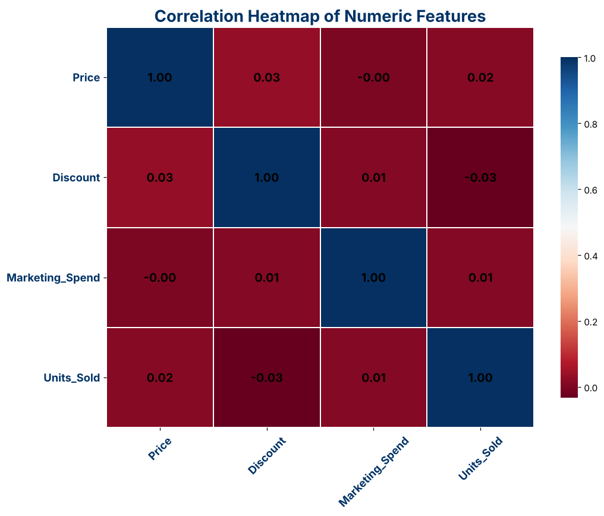
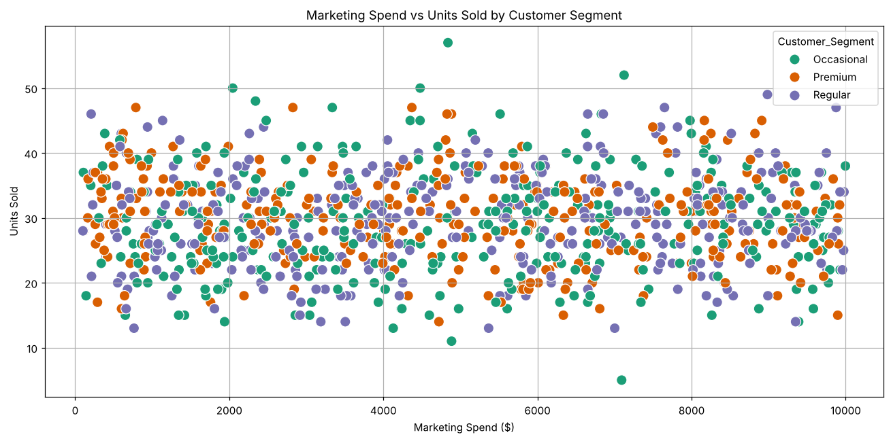

# E-Commerce Sales Analysis

**Business question:** do price, discount and marketing spend drive how many units an online shop sells, and which product categories and customer segments sell the most?

**Result:** in this dataset they do not. Across 1,000 orders (Jan 2023 to Sep 2025), price, discount and marketing spend each have a correlation with units sold between −0.03 and +0.02, so none of them explains the variation in sales. Sales are spread almost evenly: every category averages 29 to 30 units per order, and Electronics sells the most in total (6,210 units, 21% of 29,631).

**Stack:** Python, pandas, Matplotlib, seaborn, Jupyter. MSc coursework.



## Key findings

| | Finding |
|---|---|
| **Marketing spend** | Correlation with units sold is +0.01: higher spend did not mean more units |
| **Discount** | Correlation −0.03: bigger discounts did not lift sales |
| **Price** | Correlation +0.02: no price sensitivity visible |
| **Categories** | Electronics 6,210 units, Sports 6,125, Toys 6,003, Fashion 5,650, Home Decor 5,643 |
| **Customer segments** | Regular 10,222 units, Occasional 9,842, Premium 9,567; Premium orders are slightly larger (30.3 vs 29.0 to 29.6 units) |

What this means for a business: if real data looked like this, cutting discounts or marketing would not obviously cost sales, and the next step would be testing other drivers (season, channel, stock) before spending more.



More charts: [monthly share of units sold](images/monthly_units_pie.png) and [category summary](images/category_summary.png). The full write-up is in [`E-Commerce Sales Prediction - Report.pdf`](E-Commerce%20Sales%20Prediction%20-%20Report.pdf).

## What I did

- Loaded and prepared the data (date parsing, year and month features)
- Built a summary statistics table for price, discount, marketing spend and units sold
- Plotted the monthly sales split, a correlation heatmap, a category summary and marketing spend against units sold by customer segment
- Summarised the results in a business-focused report

Note: despite the repo name, the notebook does not yet contain a prediction model; it is an exploratory analysis. A regression baseline is a natural next step.

## Data and licence

`E-Commerce Sales Prediction.csv`: 1,000 rows, one per order, with Date, Product_Category, Price, Discount, Customer_Segment, Marketing_Spend and Units_Sold. It appears to be the [E-Commerce Sales Prediction Dataset on Kaggle](https://www.kaggle.com/datasets/nevildhinoja/e-commerce-sales-prediction-dataset), which describes itself as a **synthetic** dataset, so the weak relationships above are likely a property of how it was generated. The Kaggle page does not show a licence; check it before reusing the data.

Months October to December appear in only two of the three years (the data ends on 26 Sep 2025), so their monthly totals are lower.

## How to run

```bash
pip install pandas matplotlib seaborn jupyter
jupyter notebook "E-Commerce Sales Prediction - Code.ipynb"
```

Run all cells; the notebook reads the CSV from the repo folder.

*Praneet Sivakumar · [praneetsivakumar.com](https://www.praneetsivakumar.com)*
